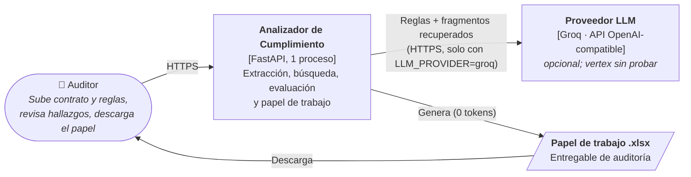
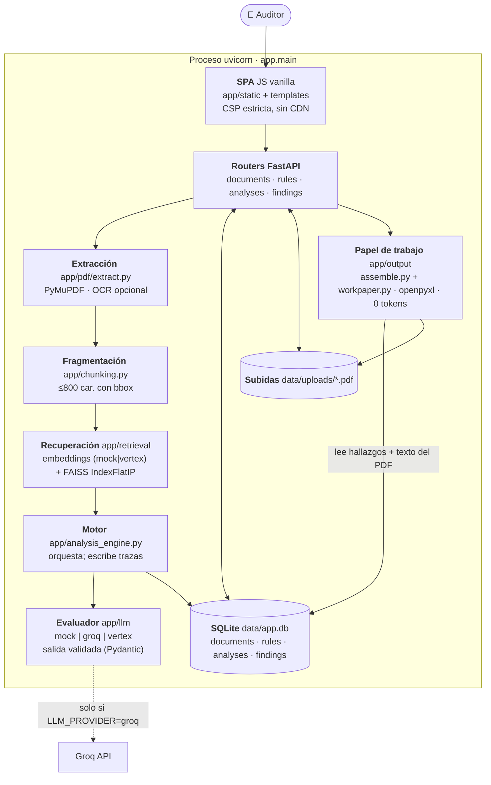
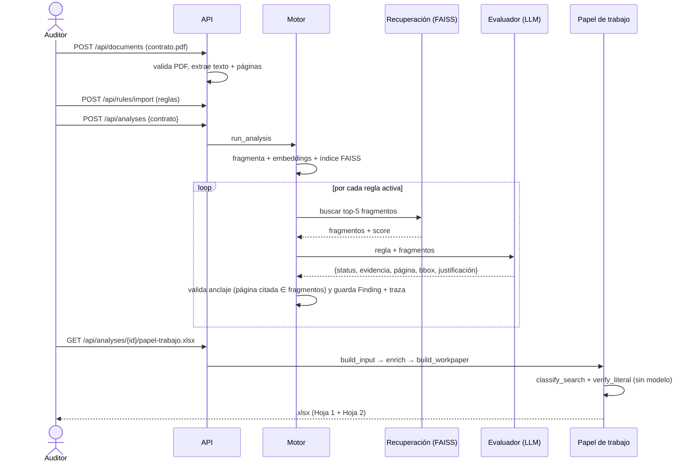

# 02 · Arquitectura

## C4 nivel 1 — Contexto
Un auditor usa la app desde el navegador. En ejecución hay **una dependencia externa opcional**: el
proveedor del LLM (Groq hoy). Con `LLM_PROVIDER=mock` no sale nada de la máquina.

**Dato que sale a Groq:** la regla y los (máx. 5) fragmentos del contrato recuperados para ella; no el PDF completo.

## C4 nivel 2 — Contenedores y componentes

| Componente | Responsabilidad | Tecnología |
|---|---|---|
| Routers | REST `/api/*`, validación, CSRF doble-cookie, cabeceras de seguridad | FastAPI, Pydantic v2 |
| Extracción | Texto por bloque con bbox (puntos PDF, origen arriba-izquierda); marca páginas escaneadas | PyMuPDF; Tesseract opcional |
| Fragmentación | Párrafos ≤ 800 caracteres, cada uno con su bbox | `app/chunking.py` |
| Recuperación | Un índice FAISS por análisis; consulta = «nombre. descripción» de la regla; `top_k = 5` | numpy, faiss-cpu |
| Evaluador | Veredicto por regla sobre los fragmentos; degrada a `requiere_revision` ante error | `app/llm/*` |
| Motor | Orquesta y persiste un `Finding` por regla con su `FindingTrace` y el `AnalysisTrace` | `app/analysis_engine.py` |
| **Papel de trabajo** | Clasifica el resultado de la búsqueda, verifica citas y arma el Excel | `app/output/*`, openpyxl |
| Persistencia | SQLite (migrable a PostgreSQL) + PDFs en disco | SQLAlchemy 2 |

## Flujo extremo a extremo

## Stack
| Capa | Elección | Notas |
|---|---|---|
| Runtime | Python 3.13 en desarrollo (el proyecto pide ≥ 3.12) | Docker `python:3.12-slim` |
| API | fastapi, uvicorn (1 worker), pydantic v2 | Estado en BD, no en memoria |
| PDF | PyMuPDF | texto, bbox, render, PDF anotado |
| Vectores | faiss-cpu + numpy | `IndexFlatIP` sobre vectores normalizados ≈ coseno |
| LLM | `httpx` directo a Groq (OpenAI-compatible) | sin SDK; sin dependencias nuevas |
| Excel | **openpyxl** (dependencia nueva de esta rama) | justificada: el papel es el entregable |
| Pruebas | pytest, httpx/TestClient | 140 pasan + 1 opt-in |
