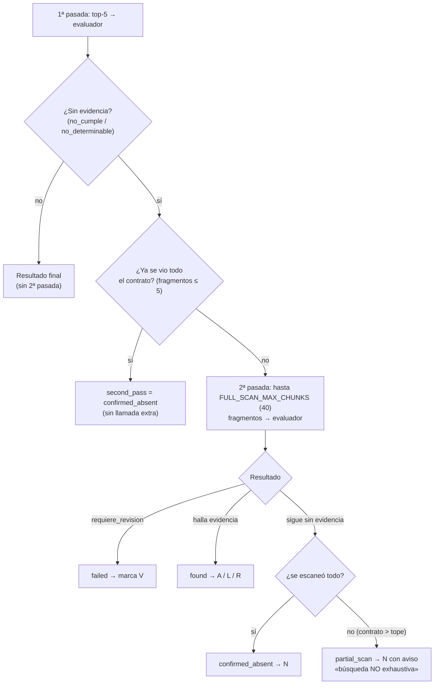
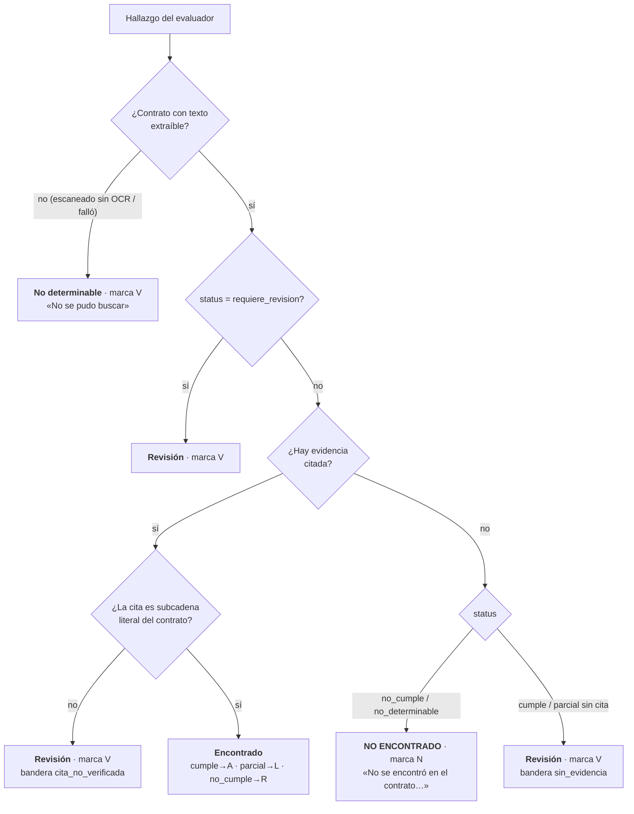

# 03 · Motor de búsqueda y validación

Para **cada regla activa** (una sola vez por análisis) el motor hace cuatro pasos. Los pasos 1, 2 y 4
son deterministas; solo el 3 puede usar un modelo.

## 1 · Buscar (recuperación)
- El contrato se fragmenta en párrafos ≤ 800 caracteres, cada uno con página y bbox.
- Se vectoriza «nombre. descripción» de la regla y se recuperan los **5 fragmentos** más similares
  (`TOP_K = 5`, FAISS `IndexFlatIP`).
- ⚠️ FAISS **siempre devuelve** los 5 más cercanos, aunque no tengan nada que ver. Por eso «no hay
  resultados» nunca es la señal de ausencia: la ausencia la decide el paso 3, se **confirma con la
  segunda pasada (3b)** y se clasifica en el 4.
- Hoy los embeddings son `mock` (hash de palabras): recuperación **léxica**, no semántica. Ver doc 07.

## 2 · Señales deterministas
`compute_lexical_signals` (sin modelo): solapamiento de palabras clave regla↔fragmento y marcadores
de negación/afirmación. Se guardan en la traza y se dan al evaluador como contexto.

## 3 · Evaluar (veredicto)
El evaluador recibe la regla y los fragmentos y devuelve `RuleEvaluationResult`:

| Estado del evaluador | Significado | Evidencia esperada |
|---|---|---|
| `cumple` | La cláusula existe y satisface la regla | sí, literal + página + bbox |
| `parcial` | Existe pero le faltan elementos | sí |
| `no_cumple` | Existe y la contradice, **o no existe** | sí si existe; no si no existe |
| `no_determinable` | No hay evidencia suficiente en los fragmentos | no |
| `requiere_revision` | Salida inválida, error de red/HTTP, cita fuera de los fragmentos | no / dudosa |

Salvaguardas del adaptador (`groq`/`vertex`): JSON inválido, error HTTP o timeout → `requiere_revision`
(nunca se inventa un veredicto); si cita una **página que no está entre los fragmentos recuperados**,
se descarta la evidencia y pasa a `requiere_revision`. Sin clave configurada → cae al evaluador `mock`.

## 3b · Segunda pasada antes de declarar «no encontrado»
Con recuperación léxica y `top_k = 5`, una cláusula con otro vocabulario puede no llegar al evaluador y
producir un **falso «no encontrado»**. Para evitarlo, cuando el evaluador no halla evidencia
(`no_cumple`/`no_determinable` sin cita) el motor **reevalúa la regla con más contrato**:

- **Costo acotado:** 1 llamada extra al LLM solo por cada regla que parece ausente; las reglas con evidencia no la usan.
- **Nunca se afirma ausencia con duda:** si la pasada ampliada falla, la regla queda en **V** («la búsqueda ampliada falló»), no en N.
- **Contratos largos:** si superan el tope, la ausencia sigue siendo N pero con bandera `busqueda_parcial` y aviso en la Hoja 1 y el anexo, para que el auditor la valide a mano.
- Configurable: `SECOND_PASS_ENABLED` (por defecto `true`) y `FULL_SCAN_MAX_CHUNKS` (40). Se registra en la traza: `second_pass`, `chunks_scanned`, `chunks_total`.

## 4 · Clasificar y validar (determinista, en el papel)
Esta es la decisión que convierte el veredicto en **resultado de búsqueda** (`classify_search`):

Reglas clave:
- **N (no encontrado)** exige que el contrato *sí* se haya podido leer. Si no se pudo leer, es **V**,
  porque no se puede afirmar que algo «no está» en un documento que no se leyó.
- **Un `cumple`/`parcial` sin cita no se acepta** (V): todo cumplimiento debe tener evidencia.
- **Una cita que no es literal** nunca queda como A/L/R: baja a V con bandera (se muestra, no se oculta).
- La comparación literal normaliza espacios, mayúsculas y Unicode; busca primero en la página citada y
  luego en todo el documento (un fragmento puede cruzar de página).

## Trazabilidad guardada por hallazgo (`Finding.trace`)
Método y fragmentos recuperados (id, página, score, extracto), señales léxicas, proveedor y modelo del
evaluador, limitaciones y si requiere revisión humana. Por análisis (`Analysis.analysis_trace`):
proveedores, modelos, `top_k`, reglas evaluadas y limitaciones (p. ej. «embeddings mock»).
